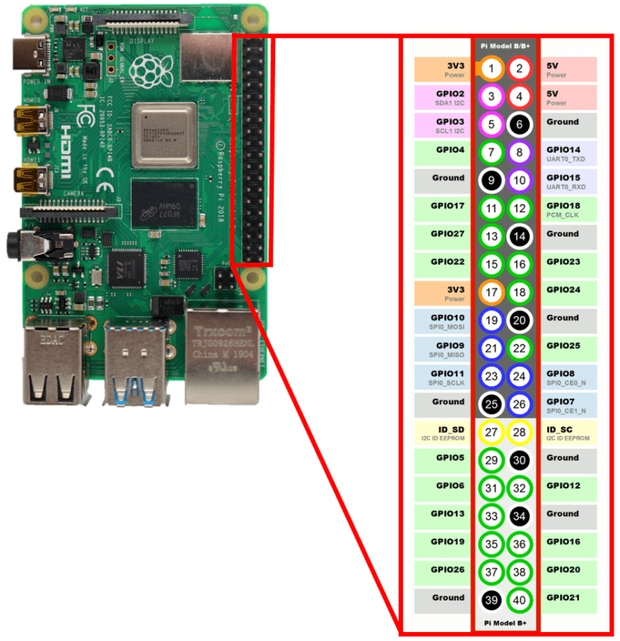

# Arcade Timer

Таймер аренды «Аркада» для **Batocera на Raspberry Pi 5**.  
Исходник: [Arcade_Timer_Arduino](https://github.com/TIMON72/Arcade_Timer_Arduino).

Сервисы Batocera: `main` · `timer` · `server` · `tvon`.

| Путь на автомате | Назначение |
|------------------|------------|
| `/userdata/system/Arcade` | checkout (исходники; источник для deploy) |
| `/userdata/system/scripts` | рабочий runtime (+ `.venv`, `wheels/`) |
| `/userdata/system/services` | скрипты автозапуска Batocera |
| `/boot/cmdline.txt` | параметры ядра (раздел **BATOCERA**, не SHARE) |

---

## С нуля: что выбрать

| Ситуация | Способ |
|----------|--------|
| Автомат уже в сети, SSH работает | **A. Заливка с ПК по SSH** |
| Свежий SSD / нет сети / серийная прошивка | **B. Offline: Mount + Copy** |
| Только ZIP с GitHub, без Windows-скриптов | **C. На самом автомате (`install`)** |

Репозиторий на Windows — источник правды. Сначала `deploy/machines.example.json` → `deploy/machines.json` (в git не коммитится).

```json
{
  "user": "root",
  "password": "linux",
  "remotePath": "/userdata/system/Arcade",
  "machines": {
    "zero": "192.168.1.72",
    "epsilon2": "192.168.1.66"
  }
}
```

Имя в командах — ключ из `machines` или IP. Пароль: `machines.json` или `ARCADE_SSH_PASSWORD`.

---

## A. С нуля по SSH (рекомендуется для отладки)

Batocera уже загружена, пинг/SSH ок.

```powershell
# 1) полный снос старого Arcade (если был)
.\deploy\clean.ps1 zero -Runtime -Venv

# 2) первая заливка: wheels + vendor + on-device deploy + старт сервисов
.\deploy\deploy.ps1 zero -Full -Restart
```

Что делает `-Full -Restart`:
- кладёт дерево в `/userdata/system/Arcade`
- на устройстве гоняет `main.py deploy` → `scripts/`, `services/`, `batocera.conf`
- создаёт `.venv` и ставит luma из `wheels/` (офлайн)
- дописывает в `/boot/cmdline.txt` защиту Pi5+NVMe (см. ниже)
- `batocera-services restart main timer server tvon`

Дальше, когда правите код с ПК, — раздел **Обычная работа с ПК**.

Чистый переустанов без смены железа:

```powershell
.\deploy\clean.ps1 zero -Runtime -Venv
.\deploy\deploy.ps1 zero -Full -Restart -NoLogs
```

Проверка после бута / power-cycle:

```bash
grep -E 'pcie_aspm=off|nvme_core.default_ps_max_latency' /proc/cmdline
ls -la /userdata/system/scripts/.venv/bin/python   # размер ≥ 64, не 0
batocera-services list | grep -E 'main|timer|server|tvon'
```

---

## B. С нуля offline (SSD на ПК)

Нужны: WSL (Ubuntu), админ-права для `wsl --mount`.

### 1. Собрать бандл `system\`

```powershell
.\deploy\deploy.ps1 -Copy C:\Temp\Batocera\system
```

Получится:

```text
system/
  Arcade/              checkout (+ wheels/vendor)
  scripts/             main timer server tvon + wheels
  scripts/.venv/       если есть vendor/venv/aarch64.tar.gz
  configs/
  services/            main timer server tvon (LF, +x после FixPerms)
  batocera.conf        system.services=main timer server tvon
  .arcade-deployed
```

### 2. Смонтировать SSD и вставить `system\`

```powershell
.\deploy\mount.ps1 -Mount
# откроется SHARE: \\wsl.localhost\Ubuntu\mnt\wsl\batocera-share
# скопировать содержимое C:\Temp\Batocera\system  →  …\batocera-share\system\
.\deploy\mount.ps1 -FixPerms          # после paste: права + +x у services
.\deploy\mount.ps1 N -Unmount         # N = номер диска из mount
```

`mount.ps1 -Mount` также сам правит **boot**-раздел:  
`/mnt/wsl/batocera-boot/cmdline.txt` ← NVMe-токены (ASPM off).

Не путать разделы:

| WSL / Explorer | Batocera | Что там |
|----------------|----------|---------|
| `batocera-share` | `/userdata` (SHARE) | roms, `system/`, Arcade |
| `batocera-boot` | `/boot` (BATOCERA) | `cmdline.txt`, образ ОС |

### 3. SSD в Pi → питание → проверка

Сервисы стартуют из `batocera.conf`. Если не было prebuilt `.venv`, `main` создаст его на первом буте (тяжелее для NVMe).

Опционально заранее снять готовый venv с живой машины:

```powershell
.\deploy\deploy.ps1 zero -PullVenv
# → vendor/venv/aarch64.tar.gz  (потом -Copy кладёт scripts/.venv сразу)
```

---

## C. С нуля только на автомате (`install`)

Без `deploy.ps1`. Положить проект в `/userdata/system/Arcade`, затем:

```bash
bash /userdata/system/Arcade/install
reboot
```

Из GitHub ZIP:

```bash
cd /userdata/system
unzip -o Arcade-main.zip
rm -rf Arcade
mv Arcade-main Arcade
bash /userdata/system/Arcade/install
reboot
```

Снятие сервисов (папку Arcade оставить):

```bash
bash /userdata/system/Arcade/uninstall
reboot
```

Принудительный deploy без reboot:  
`python3 /userdata/system/Arcade/scripts/main/main.py deploy`

---

## Pi5 + NVMe (cmdline)

На связке Pi5 + NVMe без отключения ASPM возможны зависания (`nvme: controller is down`, SSH мёртв при живом ping).

В `/boot/cmdline.txt` (одна строка, в конец) должно быть:

```text
nvme_core.default_ps_max_latency_us=0 pcie_aspm=off pcie_port_pm=off
```

Ставится автоматически: `mount.ps1 -Mount` и SSH-`deploy.ps1`.  
Через `batocera.conf` / меню Batocera **нельзя** — только boot.

Проверка: `cat /proc/cmdline | tr ' ' '\n' | grep -E 'pcie_aspm|nvme_core'`.

---

## Обычная работа с ПК

`zero` в примерах — имя из `deploy/machines.json` (можно IP).  
Без `-Full` **не** копируются `wheels/` и `vendor/` — для правок Python так и нужно.

`-Update` и `-Restart` сейчас одно и то же: файлы на автомат → `main.py deploy` в runtime → restart `main timer server tvon`.

В конце `deploy.ps1` сам открывает follow логов. Чтобы сразу выйти — добавьте `-NoLogs` к любой команде заливки.

### Поправил код — залить и перезапустить сервисы

Основной ежедневный путь. Сервисы подхватывают новый код.

```powershell
.\deploy\deploy.ps1 zero -Update
```

### Поменялись wheels, vendor или снесён .venv

Тяжёлая заливка (много записи на NVMe). После `clean.ps1 … -Venv` нужна именно она.

```powershell
.\deploy\deploy.ps1 zero -Update -Full
```

### Нужно прогнать health (ребут ×3)

Отдельный скрипт, не флаг `deploy.ps1`. Если автомат в сети — ребут. Дальше: SSH ≤1 мин, бут ≤5 мин (когда timer+server живы — `ADD_5`), 5 мин «alive». Три цикла.

```powershell
.\deploy\test.ps1 zero
```

Сначала залить правки, потом проверить:

```powershell
.\deploy\deploy.ps1 zero -Update -NoLogs
.\deploy\test.ps1 zero
```

### Залить файлы, но не рестартить сервисы

Checkout + runtime на диске обновятся, **процессы продолжат старый код в памяти**. Нужно перед Remote-SSH / F5, когда сервисы уже остановлены.

```powershell
.\deploy\deploy.ps1 zero
```

После отладки: `-Update` / `-Restart`.

### Только папка `/userdata/system/Arcade`, runtime не трогать

Файлы репозитория на автомате, `/userdata/system/scripts` не переписывается. Не сочетается с `-Update`.

```powershell
.\deploy\deploy.ps1 zero -NoDeploy
```

### Снести runtime перед чистой установкой

Останавливает сервисы. `-Runtime` — рабочие `scripts/{main,timer,server,tvon}` и service-файлы. `-Venv` — ещё и `.venv` (потом обязателен `-Update -Full` или `-Full -Restart`).

```powershell
.\deploy\clean.ps1 zero -Runtime
.\deploy\clean.ps1 zero -Runtime -Venv
.\deploy\deploy.ps1 zero -Full -Restart -NoLogs
```

### Смотреть логи

По умолчанию — общий `scripts/logs.log` (последние 5 мин, затем follow, Ctrl+C стоп).  
`-Only` — один service-лог. `-AllServices` — `logs.log` + все `*-service.log`.

```powershell
.\deploy\logs.ps1 zero
.\deploy\logs.ps1 zero -Only tvon
.\deploy\logs.ps1 zero -AllServices
.\deploy\logs.ps1 zero -SinceMinutes 10
```

SSH host keys после смены диска меняются: скрипты сами делают `ssh-keygen -R` и `StrictHostKeyChecking=no`.

---

## Отладка с ПК

На автомате: `/userdata/system/logs/<сервис>-service.log`, `/userdata/system/scripts/logs.log`.

Remote-SSH + debugpy:

1. `.\deploy\deploy.ps1 zero -NoLogs`
2. Cursor → `root@<IP>` → open `/userdata/system/Arcade`
3. F5 → compound **Arcade**

После отладки: `.\deploy\deploy.ps1 zero -Update -NoLogs`.

Обновление без ПК (если на автомате есть git):

```bash
cd /userdata/system/Arcade && git pull && reboot
```

---

## Сервисы

| Сервис | Роль |
|--------|------|
| **main** | deploy, venv, sync Arcade → system |
| **timer** | GPIO, USB Serial с Arduino, блокировка ввода; Unix-сокет |
| **server** | HTTP `:5000` → `modules/`; MQTT online и каталог игр |
| **tvon** | HDMI-CEC: ТВ → картинка → звук |
| **netbird** | VPN: бинарник и профиль в `/userdata/system/netbird`, автозапуск `wt0` |

Команда таймеру:  
`http://<IP>:5000/test?action=INCREASE|PLAYPAUSE|STOP|ADD_<INT>`

```bash
batocera-services status main
batocera-services status timer
batocera-services status server
batocera-services status tvon
```

### Netbird

Бинарник и профиль хранятся в `/userdata/system/netbird` и не стираются при перезагрузке Batocera. Сервис `netbird` восстанавливает `/usr/bin/netbird`, `/dev/net/tun`, запускает daemon и применяет management URL. Статус: `netbird --config /userdata/system/netbird/default.json status`. После новой установки один раз требуется SSO через `netbird up`.

### TVON (кратко)

Этапы: TV power → HDMI/claim → picture → audio → post-check → при необходимости ES kick.  
Порт HDMI `auto` (A-1 или A-2), предпочтительный выход закреплён в `global.videooutput=HDMI-A-1`. Конфиг: `scripts/tvon/config.toml`. После запуска сервис остаётся активным и пересоздаёт CEC keeper при потере процесса. Keeper не отправляет периодические `as`: они вызывают DRM hotplug и рестарт EmulationStation. При остановке сервиса CEC-процессы завершаются.

Если после cold boot долго нет звука — часто HDMI sink ещё `auto_null`; подождать или зафиксировать устройство в меню звука Batocera.

---

## Конфиг модулей

Править в Arcade, потом `deploy.ps1` / reboot:

- `scripts/main/config.toml` — SSH  
- `scripts/timer/config.toml` — режим, GPIO, матрица, `cmd_socket`  
- `scripts/server/config.toml` — `port`, `timer_socket`  
- `scripts/tvon/config.toml` — CEC / этапы  

`cmd_socket` и `timer_socket` должны совпадать (по умолчанию `/var/run/arcade-timer.sock`).  
`timer_mode`: `Raspberry` | `Arduino`. В режиме `Arduino` используется `serial_port` (по умолчанию `/dev/ttyUSB0`, 115200): команды и состояния идут по USB, GPIO реле не используются. Табло подключено к ESP32.

---

## MQTT: online и игры

Сервис `server` может публиковать в Вендоматику online и каталог Batocera. Конфиг — **`/userdata/system/mqtt.json`** на автомате (не коммитится и не затирается deploy). Пример: `scripts/server/mqtt.example.json`.

```json
{
  "enabled": true,
  "broker": "tcp://SERVER:1883",
  "username": "tcn-MACHINE_ID",
  "password": "YOUR_PASSWORD",
  "machineId": "MACHINE_ID",
  "topicPrefix": "tcn/MACHINE_ID",
  "gameSystems": ["nes", "dreamcast"],
  "heartbeatSec": 30,
  "gamesRefreshSec": 60
}
```

`machineId` — серийный номер аркады в PWA. Учётку выдаёт gateway: `/app/mqttcredentials -machine <id>` или кнопка «Учётка брокера» у суперадмина. После правки файла перезапустить `server`.

- `…/status`: heartbeat 30 с, `source=raspberry`, LWT `offline`.
- `…/event`: `type=arcade.games`, снимок `/userdata/roms/*/gamelist.xml`; публикация при изменении и при подключении.
- В отчёт аркады попадают название, система, `playcount`, `gametime`, `lastplayed` и `favorite`; сначала самые частые игры. `gametime` — суммарные секунды, в PWA показываются минуты.
- `gameSystems` ограничивает системы каталога; без него публикуются все. Записи, у которых ROM отсутствует на диске, не публикуются.
- Если `gamelist.xml` после сбоя стал нулевым, агент восстанавливает его из `/usr/share/batocera/datainit/roms/` и перечитывает.

### Управление файлами

В отчёте аркады с правом `machines.edit` доступны загрузка и удаление ROM:

- Перед загрузкой выбираются система и ROM-файл.
- Файл передаётся частями по 4 МБ с проверкой SHA-256, максимум 2 ГБ.
- Новый ROM добавляется в `gamelist.xml`, а EmulationStation автоматически перезапускается и сразу показывает игру. При удалении также обновляется список на экране автомата.
- Удаление перемещает файл в `/userdata/system/arcade-trash/` вместо безвозвратного стирания. Через 7 дней файл удаляется из карантина автоматически, очистка запускается при старте и раз в сутки.
- Существующие файлы с таким именем не перезаписываются.
- Без оплаченного времени USB-контроллеры захватываются через EVIOCGRAB: стрелки и кнопки громкости `BTN_BASE5/6` пробрасываются через виртуальное устройство `/dev/uinput`, а запуск и игровые кнопки блокируются. Во время игры физические контроллеры полностью отпускаются. Это отдельно от реле.

Зависимость `paho-mqtt==2.1.0` ставится из `wheels/` вместе с остальными при полном deploy с `-Full`.

Полная инструкция по обновлению и подключению новых автоматов: [MQTT_SETUP.md](MQTT_SETUP.md).

---

## Железо (GPIO BCM)



| Что | Подключение |
|-----|-------------|
| Arduino ESP32 | USB → Raspberry (`/dev/ttyUSB0`) |
| MAX7219 DIN / CLK / CS | ESP32 GPIO 16 / 25 / 17 |
| Терминал (сухой контакт) | Pi BCM 26 (+ GND) |
| RF + / play / stop | ESP32 GPIO 23 / 19 / 18 |

Реле buttons/play/stop и их входы на Pi для текущей Serial-схемы не нужны. БП Pi5: ориентир **5 V / 5 A**.

---

## Офлайн-зависимости в репо

| Путь | Зачем |
|------|--------|
| `wheels/` | pip offline (luma) |
| `vendor/git/` | портативный git |
| `vendor/vscode/` | VSIX для Cursor |
| `vendor/venv/aarch64.tar.gz` | готовый `.venv` для `-Copy` (после `-PullVenv`) |

Не в git: `.venv/`, `logs.log`, `.arcade-deployed`, `deploy/machines.json`.
